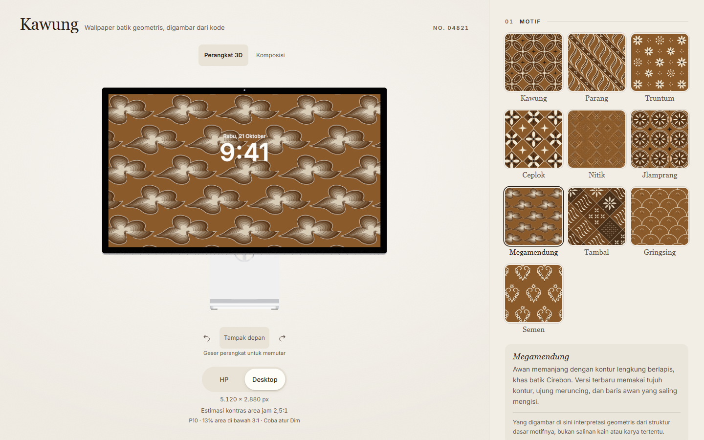

# Kawung

A procedural wallpaper editor with ten geometric interpretations of batik motifs. Adjust palette, density, line weight, rotation, seed and Dim; inspect the artwork in a device preview; export a PNG or share its configuration.

[Live app](https://kawung.vercel.app) · [Portfolio case study](docs/PORTFOLIO.md) · [Release verification](docs/RELEASE.md)



## Run locally

```sh
pnpm install --frozen-lockfile
pnpm dev
```

Use Node.js 24 and pnpm 11.25. The source server runs on 4185. `pnpm build` creates the production bundle; `pnpm preview` serves it on 4186. `pnpm-lock.yaml` is the canonical lockfile.

Licensed model files and generated device resources are deliberately absent from source control. A fresh clone runs the editor and composition preview; 3D falls back to composition until the resources are installed. Obtain the assets through their creators and follow [conversion and packaging instructions](docs/DEVICE-ASSETS.md). The public release includes the resources; they are outside the source code's MIT license.

## Features

- **Ten motifs:** Kawung, Parang, Truntum, Ceplok, Nitik, Jlamprang, Megamendung, Tambal, Gringsing and Semen, with structural references and interpretation limits.
- **Reproducible composition:** one procedural scene supplies SVG, Canvas PNG and the dynamic device texture. Settings and dimensions are pinned in the share link. Different seeds can still produce identical designs.
- **Dim:** -80% to +80% adjusts all palette colors by interpolating encoded sRGB channels and is included in the PNG.
- **Native device previews:** draggable Studio Display and iPhone 18 Pro Max Burgundy models with full-resolution screen textures and button-based rotation. Custom-size artwork uses composition view until a native model size is explicitly selected.
- **Flat composition:** front-only iPhone and Studio Display bezels with proportional screens; persistent date and clock overlay, a simple flat monitor stand and no faux perspective.
- **Clock-area estimate:** choose light/dark text by weak-contrast area coverage and report P10. This is an area proxy, not a human readability result or accessibility certification.
- **Local operation:** no backend, account, analytics or third-party application requests. Font and model resources are served locally.

Stack: React, TypeScript, Vite, Tailwind CSS, Three.js, Vitest and Playwright.

## Evidence

The [downloaded-device restoration](docs/DEVICE-RESTORATION.md) records the latest local model and logo changes. The [motif and composition revision](docs/MOTIF-REVISION.md) records the latest changes and checks. The [stage-two report](docs/STAGE-TWO.md) summarizes implementation and measured results. The [evaluation protocol](docs/EVALUATION.md) defines 5,000 seed renders and 720 fixed contrast configurations, including the baseline, comparison raster, regressions and limitations. Raw CSV/JSON and source hashes are in [verification/stage-two](docs/verification/stage-two).

```sh
pnpm test
pnpm build
pnpm test:e2e
# With pnpm dev running:
node scripts/evaluate.mjs
```

Playwright needs an installed browser. `PLAYWRIGHT_EXECUTABLE_PATH` selects an existing Chrome binary; `E2E_BASE_URL` reuses a running preview. Device integration tests require the locally licensed GLBs. The ordinary editor, composition, clipboard and export tests remain independent of those assets.

## Scope and limitations

Kawung uses procedural geometry, not a trained ML model or batik image dataset. [Motif references](docs/MOTIF-REFERENCES.md) support the structural features; a batik practitioner or curator has not authenticated the drawings. They do not reproduce a particular cloth or establish rules for ceremonial use.

P10 and the percentage below 3:1 describe a sampled rectangle behind the preview clock. They do not measure glyph visibility, user reading performance, OS cropping or physical display quality. GPU limits can reduce preview texture size; PNG output has explicit canvas limits and recoverable errors.

Ceplok's old generator is preserved for legacy links. New changes use `g=3`, refining Nitik, Megamendung and Tambal while preserving version-1/2 shared artwork. Coarse image hashes indicate repeated representations, not perceived uniqueness.

## Credits and licenses

App and original motif geometry: Steven Gerald Cahyadi. Code is MIT; [Inter](https://rsms.me/inter/) uses SIL OFL 1.1. Device meshes have separate third-party terms and are not MIT. Provenance and release restrictions are recorded in [DEVICE-ASSETS.md](docs/DEVICE-ASSETS.md). Product UI omits source/GitHub links while the repository retains these records.

See [method notes](docs/method.md) and the historical [stage-one report](docs/STAGE-ONE.md).
