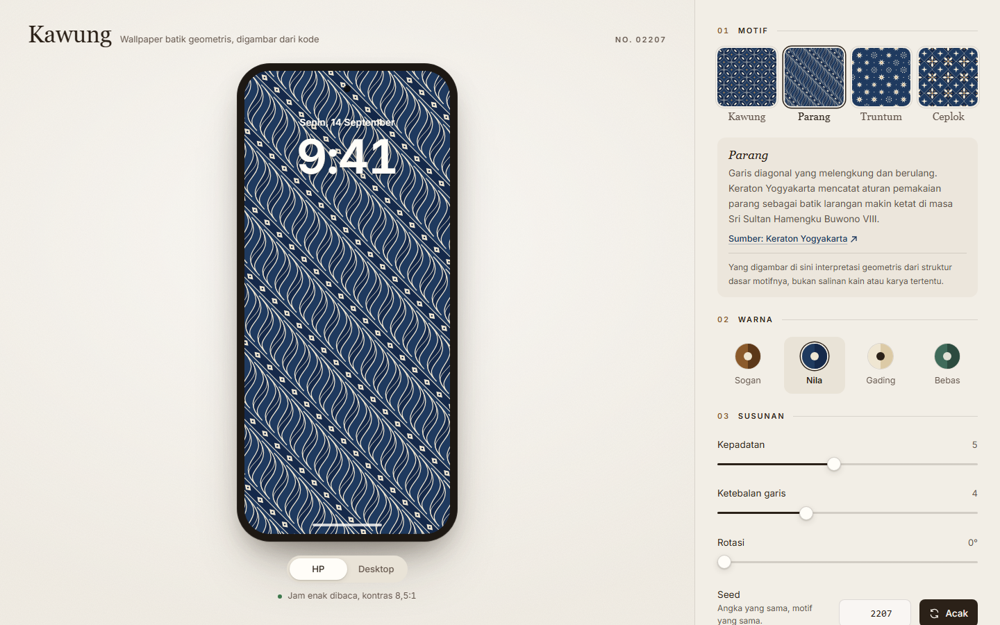
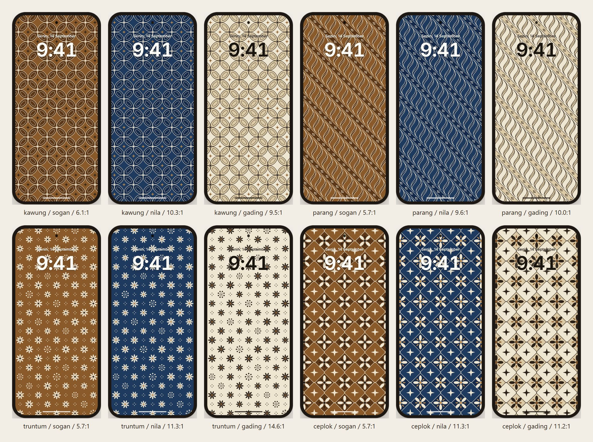

# Kawung

Make a phone wallpaper with a geometric batik motif that nobody else has. Pick a motif, a palette and a seed, check it behind a lock screen clock, then download a PNG sized for the screen you are holding.

## Problem

Batik wallpapers online are mostly photos of fabric: low resolution, the wrong aspect ratio for a phone, and the same file for everyone. I wanted something that is sharp at the real screen resolution, looks like the structure of a known motif, and is different for every person, while still being reproducible from a short link.

## Who it's for

People who want a quiet, personal lock screen with an Indonesian motif. Also anyone curious how a traditional pattern breaks down into simple geometry.

## Demo

https://kawung.vercel.app

Example link: `https://kawung.vercel.app/?m=kawung&s=4821&p=nila`

## How it works

1. **Motifs as code.** Each motif is a function that draws simple shapes on a grid.
   - Kawung: four ellipses around one centre point. The ellipses sit on the edges of a diagonal lattice, so four tips meet at every junction. Petal length is solved from the petal width (`A^2 + B^2 < reach^2`) so neighbouring petals come close but never overlap.
   - Parang: slanted bands. Each band holds a row of S-shaped blades built from two cubic curves, with a strip of small diamonds between bands.
   - Truntum: small blossoms on a diagonal grid, with tiny dots between them.
   - Ceplok: one symmetric rosette per square, plus an ornament where four squares meet.
2. **Seeded randomness.** A `mulberry32` PRNG picks the variations (petal fatness, blade style, blossom mix, ornament type). Per-cell choices use a hash of `(seed, i, j)`, so a cell looks the same no matter how many cells are drawn around it. That keeps the motif stable when the same link is opened on a screen with a different shape.
3. **One scene, two renderers.** The motif produces a list of path strings. The preview turns it into an SVG string, the export draws the same paths on a `<canvas>` with `Path2D`. The short side of the scene is always 1000 units, so density and line weight look the same in the thumbnail, the preview and the PNG.
4. **Export size from the screen.** PNG size is `screen.width x devicePixelRatio` by `screen.height x devicePixelRatio`, short side first for the phone option and long side first for the desktop option. No table of phone models to keep up to date. Very large screens are scaled down to stay under the 16,777,216 pixel canvas limit of iOS Safari.
5. **Share link.** Every setting lives in the query string (`m`, `s`, `p`, `c`, `d`, `w`, `r`, `v`). The address bar is always the share link.
6. **Clock readability.** The app renders a small copy of the wallpaper, samples the pixels behind the clock, and picks light or dark text based on the higher median contrast. The ratio is shown under the preview.

Stack: Vite, React, TypeScript, Tailwind CSS, Vitest, Playwright. No backend, no API, no analytics. The page makes no requests to other domains.

More detail in [docs/method.md](docs/method.md).

## Data and licenses

There is no dataset. Motif geometry is written from scratch as a geometric interpretation of each motif's basic structure, not a copy of any specific cloth or artwork.

The short notes about each motif are paraphrased from pages I opened and checked, listed in [docs/sources.md](docs/sources.md):

- Keraton Yogyakarta, "Motif Batik Larangan Keraton Yogyakarta" (kawung, parang)
- Museum Sonobudoyo Yogyakarta, "Mengenal Batik Khas Jogja: Filosofi di Balik Keindahan Motifnya" (truntum, ceplok)

The Inter font is bundled from `@fontsource-variable/inter` (SIL Open Font License 1.1). Code is MIT, see [LICENSE](LICENSE).

## Evaluation

What is checked automatically:

| Check | How | Result |
|---|---|---|
| Same seed, same SVG | Vitest snapshot per motif, plus an identical-string check | passing |
| PNG size matches the computed size | Playwright downloads the PNG and reads width and height from the PNG header (393 x 852 at 3x gives 1179 x 2556, 1440 x 900 at 2x gives 2880 x 1800) | passing |
| Share link reproduces the wallpaper | Playwright changes every setting, opens the link in a new tab, compares the SVG markup | passing |
| Clock readable on 4 motifs x 3 palettes | Playwright screenshots in `docs/screenshots/`, median clock contrast per combination in [docs/readability.md](docs/readability.md) | lowest 5.7:1 (sogan), highest 14.6:1 (truntum on gading), all 12 above 4.5:1 |
| No console errors at 375 px and 1440 px | Playwright | passing |

## Limitations

- On a laptop the phone export uses the laptop screen's proportions. For a wallpaper that fits a phone exactly, open the share link on the phone and download there.
- The contrast number is a median over the area behind the clock. A busy motif can still feel harder to read than the number says, especially the small date line.
- The motifs are simplified. Real batik has isen (fill patterns), hand-drawn irregularity and many regional variants that this does not try to reproduce.
- `<a download>` on older iOS versions may open the image in a new tab instead of saving it. Long-press and "Save to Photos" works there.

## What I learned

- Drawing the motif as data (path strings) instead of directly as SVG made the canvas export almost free. The first idea was to rasterise the SVG through an ``, which is less predictable across browsers.
- Rounding every coordinate to two decimals was needed for the snapshot test. Without it, tiny float differences made "identical" SVGs differ.
- Hashing the grid position into the seed, instead of pulling numbers from one long random stream, keeps the pattern stable when the screen shape changes.
- The kawung petals overlapped at first. Working out the touch condition for two ellipses at 90 degrees gave a one-line rule for the petal length.
- iOS Safari has a canvas area limit, so export size needs a cap even when the math says otherwise.

## Credits

Built by Steven Gerald Cahyadi ([SevenZ27](https://github.com/SevenZ27)). Motif notes paraphrased from Keraton Yogyakarta and Museum Sonobudoyo. No generated images or video are used, every visual is drawn by code.
