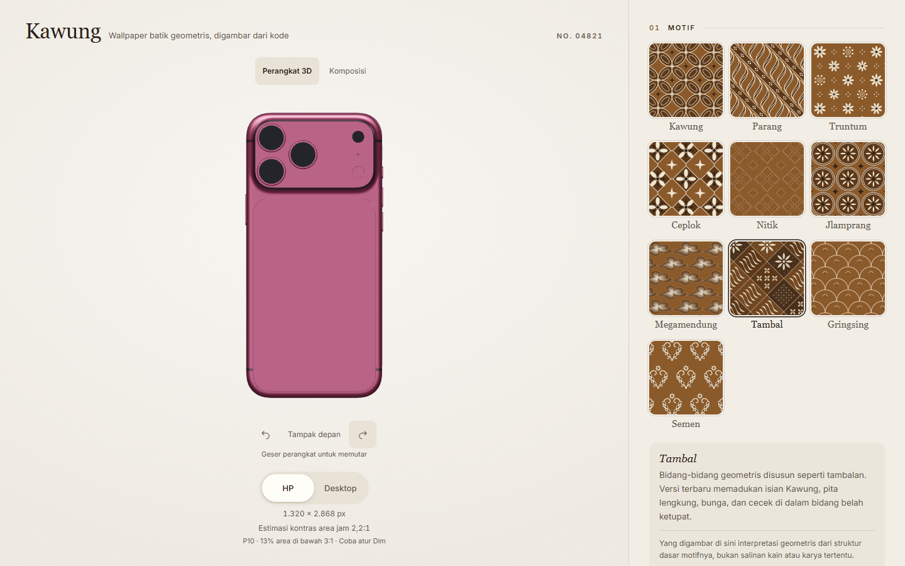
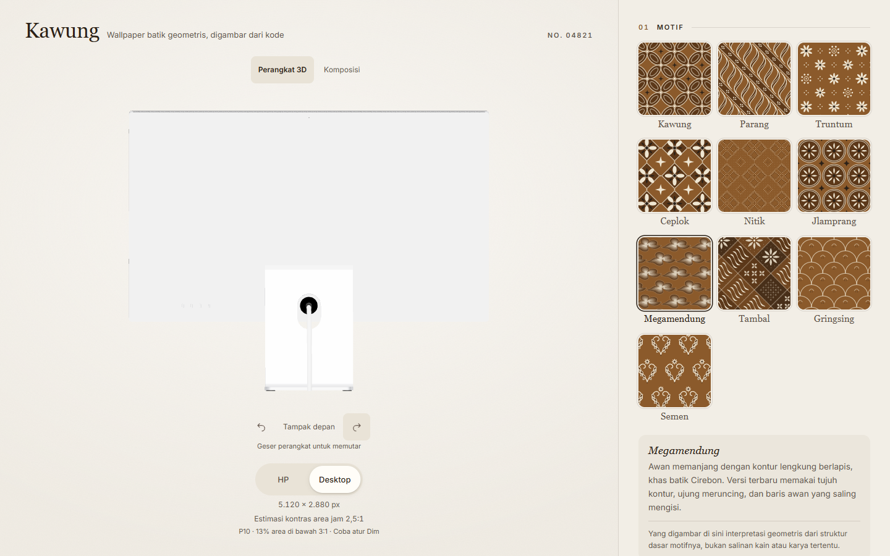

# Pemulihan model unduhan tanpa logo

21 Oktober 2026. Catatan checkpoint pemulihan model di preview lokal port 4186. Pengemasan dan status publik berikutnya dicatat terpisah di [catatan rilis](RELEASE.md).

## Perubahan

Model iPhone 18 Pro Max Burgundy dan Studio Display unduhan digunakan kembali. Model parametrik pengganti disimpan di arsip lokal `qa/rejected-parametric-models/` dan tidak lagi dimuat aplikasi.

Pemeriksaan visual terhadap mesh terisolasi mengidentifikasi dua lapisan logo pada iPhone (`lOvBmzvFYioveSv`, `XSQLGTTQPOzWnxm`) dan satu logo pada Studio Display (`YrhTpmJzRMIDxdd`). Ketiga mesh dihapus dari salinan model. Input yang belum diubah tetap disimpan di `qa/assets/converted-local-only/`.

`pnpm models` menjalankan `scripts/restore-devices.mjs`. Script membandingkan hash atribut mesh, indeks dan matriks transformasi sebelum dan setelah pemrosesan. Seluruh 94 mesh iPhone dan 83 mesh Studio Display yang bukan logo, termasuk `WallpaperScreen`, tetap identik setelah decoding. [Manifest](verification/device-logo-removal.json) mencatat hash input/output dan hasil pemeriksaan. Sumber, bahan dan batas lisensi tercatat di [DEVICE-ASSETS.md](DEVICE-ASSETS.md).





## Perilaku dan pemeriksaan

Kontrol motif, palet, Dim, seed, ukuran, komposisi 2D, jam, rotasi 3D, ekspor PNG dan link berbagi dipertahankan. Tidak ada perubahan pada generator motif atau perhitungan kontras.

- Build dan TypeScript lulus; 72 tes unit lulus.
- Seluruh 41 tes E2E lulus setelah model dipulihkan. Suite mencakup sepuluh motif pada dua orientasi, tekstur layar versus PNG, rotasi/reset, tautan lama, clipboard gagal/lambat, panel mobile, keyboard, reduced motion dan pemulihan ekspor gagal.
- Pemeriksaan visual menemukan screenshot canvas kosong pada WebKit mobile meskipun status pemuatan sudah siap. Gejala ini tidak konsisten saat diulang. Viewer kini mempertahankan drawing buffer karena hanya merender ketika ada perubahan; ini menjaga frame terakhir tanpa menjalankan loop render terus-menerus. Konsekuensinya adalah tambahan penyimpanan buffer GPU, bukan perubahan resolusi wallpaper.
- Setelah perubahan buffer, lima tes perangkat yang terdampak dijalankan ulang dan lulus. Tes memeriksa piksel canvas ketika idle dan kesamaan gambar setelah reset; pemeriksaan reset menunggu frame dipresentasikan compositor, bukan hanya flag akhir animasi.
- Delapan kasus Chrome 155.0.8059.85 / WebKit 26.6 memeriksa kedua model pada 1440×900 DPR 1 dan 390×844 DPR 3. Seluruhnya memiliki piksel perangkat yang terlihat, tanpa runtime error, overflow horizontal atau temuan axe. Tampak depan, miring dan belakang diperiksa melalui screenshot. [Hasil browser](verification/release-restored.json).

Tekstur tetap 1320×2868 untuk iPhone dan 5120×2880 untuk monitor pada lingkungan uji. Screenshot mobile menggunakan emulasi browser; bukan pengujian iPhone fisik. Peringatan build untuk modul 3D di atas 500 kB masih ada, dengan pemuatan modul terpisah seperti sebelumnya.

## Menjalankan kembali

```sh
pnpm models
pnpm models:package
pnpm test
pnpm build
pnpm test:e2e
```

Input model memerlukan file lokal yang diperoleh melalui pembuatnya; file GLB tidak dilacak Git. Untuk memakai preview yang sudah berjalan, atur `E2E_BASE_URL=http://127.0.0.1:4186`. `PLAYWRIGHT_EXECUTABLE_PATH` memilih Chrome lokal. Pemeriksaan jaringan pada mesin ini membedakan host yang disisipkan antivirus melalui `E2E_ENVIRONMENT_HOSTS`; antivirus tetap aktif.
