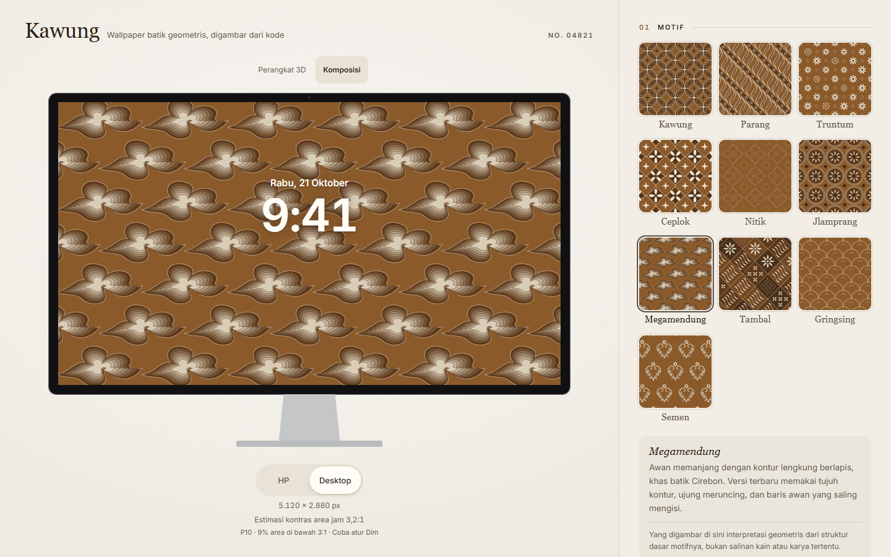

# Revisi Komposisi, motif, dan motion

21 Oktober 2026. Hasil tersedia lokal pada port 4186; belum dipublikasikan atau didorong ke Git. Revisi ini meneruskan tahap dua dan mempertahankan arsip evaluasi versi 2.

## Hasil yang terlihat

- Komposisi memakai iPhone dan Studio Display tampak depan: bezel datar, sudut layar proporsional, serta stand monitor sederhana. Tidak ada sisi bodi, perspektif buatan, atau bayangan kedalaman pada frame 2D.
- Tanggal dan jam selalu tampil. Tidak ada tombol Jam. Bingkai, stand, tanggal, jam dan island tidak masuk PNG; sudut PNG tetap persegi penuh.
- Rasio bidang layar mengikuti dimensi PNG. Perpindahan HP/Desktop dari preset native memilih 1320 × 2868 atau 5120 × 2880, sehingga ukuran iPhone tidak terbawa menjadi monitor terlalu lebar. Ukuran kustom pada tautan lama tetap dipertahankan.
- Nitik versi 3 memakai bunga berundak dari titik persegi, rangkaian belah ketupat, dan isian kecil. Megamendung memakai tujuh kontur memanjang dengan lengkung balik dan ujung meruncing. Tambal memadukan isian Kawung, pita diagonal, bunga, dan cecek dalam bidang belah ketupat. [Rujukan museum dan batas interpretasi](MOTIF-REFERENCES.md) mencatat gambar yang diperiksa langsung.
- Tautan `g=1`/tanpa versi dan `g=2` mempertahankan geometri sebelumnya. Pemilihan motif/seed baru memakai `g=3`.

## Motion dan perbaikan audit

Pergantian perangkat atau proyeksi memakai exit 140 ms lalu entrance 240 ms. Permintaan terbaru membatalkan perpindahan sebelumnya. Motif, seed, dan palet memakai crossfade 320 ms tanpa blur atau pembesaran wallpaper. Slider tetap merespons langsung. Panel mobile berubah tinggi selama 340 ms; latar dan isi panel ikut memudar. Tombol rotasi 3D memakai easing 260 ms, sedangkan drag langsung mengambil alih. Reduced motion melewati jeda perpindahan dan gerak nonesensial.

Kesiapan model menunggu tekstur dengan font selesai dimuat. Audit panel terbuka menemukan peran dialog pada elemen `aside` yang tidak sesuai; pembungkus diganti dengan elemen yang mendukung role tersebut. Catatan di dasar panel juga diperbaiki agar tidak menjadi landmark contentinfo bersarang. Focus trap, Escape, backdrop dan pengembalian fokus tetap berfungsi.

## Pemeriksaan

| Pemeriksaan | Hasil dan cakupan |
|---|---|
| Build dan TypeScript | Lulus. Peringatan bundel 3D lebih dari 500 kB masih ada; modul dimuat terpisah. |
| Unit | 72 tes lulus, termasuk determinisme, kompatibilitas tautan dan batas numerik. |
| Browser E2E | 41 tes lulus. Setelah perbaikan semantik panel terakhir, pemeriksaan modal/fokus yang terdampak dijalankan ulang dan lulus. |
| Komposisi responsif | 24 kasus Chrome 155.0.8059.85 dan WebKit 26.6, viewport 1440×900, 390×844, 320×568 dan 812×375; DPR 1–3. Rasio layar, keberadaan jam, batas frame/stand, overflow, runtime error dan axe diperiksa. |
| Motion dan panel terbuka | 4 kasus tambahan: kedua browser pada 1440×900 dan 390×844. Rotasi di tengah animasi, opacity antarframe, pembatalan pilihan perangkat, palet bebas, warna, semua slider, seed, panel dan Escape diperiksa. Nol temuan axe dan runtime error pada hasil akhir. |
| PNG dan 3D | Sepuluh motif diuji pada dua orientasi; SVG dan PNG dibandingkan pada toleransi antialiasing. Tekstur native Nitik pada iPhone dan Megamendung pada monitor dibandingkan dengan PNG, termasuk rotasi, reset depan dan Dim. |
| Error dan akses | Model/chunk gagal, clipboard ditolak/lambat, PNG gagal lalu dicoba ulang, keyboard, focus trap, reduced motion dan tautan lama tercakup dalam E2E. |

Screenshot akhir diperiksa, termasuk desktop, HP kecil, lanskap dan panel yang digulir. Tes browser memakai emulasi viewport di komputer ini; bukan uji perangkat iPhone fisik atau jaminan 60 fps. Pengambilan frame WebKit lebih jarang daripada Chrome, sehingga verifikasi motion memakai sampel dari awal klik, bukan satu pembacaan pada waktu tetap.

Tes jaringan mengidentifikasi request yang disisipkan antivirus lokal ke `gc.kis.v2.scr.kaspersky-labs.com`. Host tersebut dicatat lewat `E2E_ENVIRONMENT_HOSTS` untuk membedakan request lingkungan dari aplikasi; antivirus tidak dinonaktifkan.

## Evaluasi generator versi 3

Suite tetap: 500 seed per motif, total 5.000 render; 720 konfigurasi kontras. Protokol, seed dan palet sama seperti [evaluasi tahap dua](EVALUATION.md), dengan versi geometri 3. Semua hasil, termasuk benturan dan regresi, disimpan.

| Motif yang diubah | SVG unik / 500 | Raster 64×64 terkuantisasi unik / 500 | Median / P95 pembentukan SVG |
|---|---:|---:|---:|
| Nitik | 487 | 245 | 5,5 / 7,7 ms |
| Megamendung | 500 | 500 | 4,6 / 7,9 ms |
| Tambal | 500 | 500 | 9,1 / 11,7 ms |

Nitik memiliki lebih banyak kemiripan daripada versi 2 pada suite thumbnail ini (versi 2: 490 raster unik). Struktur yang lebih rapat dan teratur tidak otomatis menghasilkan lebih banyak variasi yang dapat dibedakan. Angka unik SVG/raster bukan skor autentisitas batik atau persepsi manusia. Detail baru menambah biaya geometri; ukuran SVG Tambal dalam sampel performa mencapai sekitar 956 ribu karakter. Pengukuran ini hanya scene+SVG, bukan seluruh frame GPU atau waktu interaksi.

Dengan geometri versi 3, pemilih warna jam saat ini menghasilkan rata-rata area di bawah 3:1 sebesar 2,980%, dibanding 3,741% untuk baseline median 90 px pada geometri yang sama: 47 kasus membaik, 1 memburuk, 672 sama. Regresi tetap Jlamprang/Sogan/desktop, seed 137, Dim 0: 25,349% menjadi 28,300%. Error absolut rata-rata P10 terhadap raster referensi 720 px sebesar 0,575.

Angka 2,980% tidak berarti geometri versi 3 lebih mudah dibaca daripada versi 2 (laporan versi 2: 2,806%). Perubahan ini memperbaiki struktur visual motif; kontras tidak meningkat universal. Dim ±60 menghilangkan area di bawah 3:1 pada suite ini, tetapi tidak menjadi jaminan untuk seluruh kombinasi atau pembaca.

## Bukti dan reproduksi

- [Manifest hash sumber](verification/motif-revision/manifest.json), [hasil generator](verification/motif-revision/results.json), [CSV kontras](verification/motif-revision/readability.csv).
- [Pemeriksaan responsif](verification/motif-revision/browser.json), [motion/panel terbuka](verification/motif-revision/motion.json).
- `pnpm test`, `pnpm build`, lalu `pnpm test:e2e`. Tetapkan `E2E_BASE_URL` untuk memakai preview yang sudah berjalan.
- Dengan Vite port 4185 berjalan: `EVAL_GENERATION=3 node scripts/evaluate.mjs` (atur environment sesuai shell). Folder keluaran versi 3 terpisah dari tahap dua.
- `scripts/verify-composition.mjs` dan `scripts/verify-motion.mjs` menyimpan pemeriksaan tambahan. `UI_PLAYWRIGHT_ENTRY` dapat memilih runtime Playwright; `UI_AXE_PATH` menunjuk instalasi axe-core. Run ini memakai Playwright 1.63 dan axe dari instalasi lokal FeedingTomorrow untuk Chrome/WebKit; suite E2E repo memakai Playwright 1.60. Browser WebKit dipilih lewat `PLAYWRIGHT_BROWSERS_PATH`.

Model perangkat lokal dan batas lisensinya tetap seperti [DEVICE-ASSETS.md](DEVICE-ASSETS.md). Tidak ada foto kain referensi yang dibundel, dan belum ada validasi bentuk oleh pembatik/kurator.
