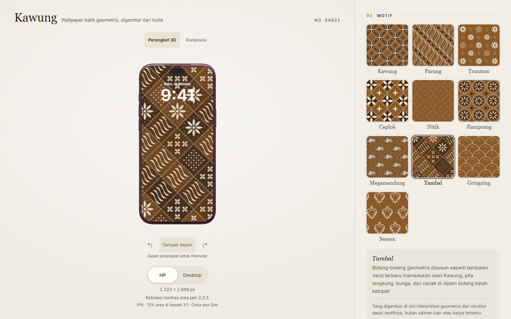

# Kawung

Kawung is a browser-based wallpaper editor that turns ten batik-inspired geometric systems into reproducible compositions. Users adjust motif, color, density, line weight, rotation, seed and brightness; preview the result on a phone or monitor; and export a PNG at a pinned resolution.

[Live app](https://kawung.vercel.app) · [Source](https://github.com/SevenZ27/kawung)

The [release record](RELEASE.md) identifies the published revision and its verification evidence.

## Product and engineering decisions

The core problem was consistency: a wallpaper should retain its composition when shared, viewed on another screen or exported. A single procedural scene now supplies SVG preview, Canvas PNG and the live texture inside the Three.js device. The URL stores output dimensions and generator version as well as visual settings. Old links retain the earlier geometry; new designs use version 3.

The editor offers a flat front-view composition and an interactive 3D view. Both show a preview-only clock. Device casing, clock and stand are excluded from exported artwork. The 3D device meshes are third-party assets supplied by the user; integration covers materials, dynamic wallpaper mapping, interaction and verification. Their logos have been removed. Screen ratios match the 1320 × 2868 and 5120 × 2880 presets. See [asset provenance](DEVICE-ASSETS.md).

Mobile controls use a collapsible panel with keyboard focus management and recoverable clipboard/export states. Device changes wait for a short exit before the next view appears; interrupted transitions settle on the latest choice. Reduced-motion preferences bypass nonessential animation. WebGL failure returns to the usable composition editor.

## Algorithm evaluation

The generator is procedural rather than a trained model. Its evaluation uses 500 fixed seeds for each of ten motifs, plus 720 fixed clock-area contrast configurations. Source hashes, per-case results and the baseline protocol are available in the repository.

The revised clock-color heuristic reduced the mean sampled area below 3:1 contrast from **3.741% to 2.980%**, compared with a median-based baseline on the same version-3 geometry. Of 720 cases, 47 improved, one regressed and 672 were unchanged. This measures a rectangular background region, not actual glyph readability or a human reading task.

Seed variation is also bounded. Nitik produced 487 distinct SVGs but only 245 distinct quantized 64 × 64 raster signatures across 500 seeds. Megamendung and Tambal produced 500 of each. These signatures measure repeated representations, not cultural authenticity or perceived diversity. The more structured Nitik design has fewer thumbnail-distinct variants than its previous version.

The [evaluation protocol](EVALUATION.md), [version-3 results](MOTIF-REVISION.md#evaluasi-generator-versi-3) and [raw data](verification/motif-revision/results.json) preserve the unsuccessful cases alongside the improvements.

## Contribution and stack

This personal project covers UI implementation, procedural motif geometry, shared rendering, versioned state, device integration, contrast estimation, browser testing and documentation. Development used AI assistance; the repository and its tests provide the implementation evidence. Museum and maker references informed motif structure; the drawings have not been authenticated by a batik practitioner or curator. See [motif references](MOTIF-REFERENCES.md).

React, TypeScript, Vite, Tailwind CSS, Three.js, SVG, Canvas, Vitest and Playwright support the implementation. No backend, user account or analytics service is required.

## Verification and limits

The local app has a 72-unit-test and 41-browser-test suite. Coverage includes all ten motifs in both export orientations, native GPU texture versus PNG comparison, device rotation, legacy links, mobile focus, reduced motion, clipboard failures and export recovery. [Model restoration checks](DEVICE-RESTORATION.md) record the latest verification after returning to the downloaded models.

Browser viewport emulation does not establish performance on a physical phone. The 3D module is lazy-loaded but still triggers the build's 500 kB chunk warning. The project has no participant usability study, human readability validation or machine-learning accuracy claim.

## Walkthrough for an interview

1. Select Tambal and change density, palette and Dim. Show the same artwork in composition and 3D views.
2. Switch between phone and monitor presets, rotate the device, then export a PNG. Explain why the clock and casing do not appear in the file.
3. Copy the URL and reopen it. Explain deterministic seeds, pinned dimensions and generator versions.
4. Open the evaluation results. Discuss the baseline, Nitik collisions and the single contrast regression rather than claiming every configuration improved.
