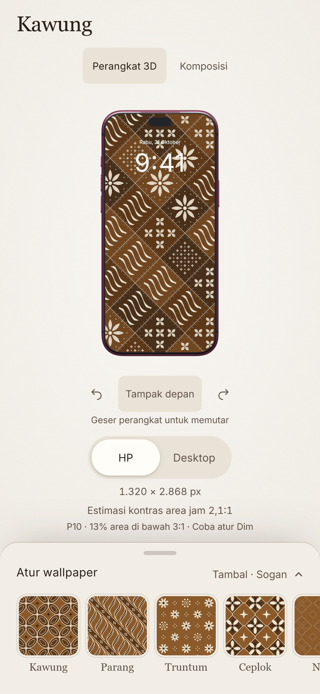

# Kawung release

Published and verified on 21 October 2026 at [kawung.vercel.app](https://kawung.vercel.app).

- Application source: [`5f7da57`](https://github.com/SevenZ27/kawung/commit/5f7da57e442a7c15af08ff2fcdb824f87899ae44).
- Vercel deployment: `dpl_6pqXBbQ2mXje13vbRPJe8dgyNYME`, [deployment URL](https://kawung-gvmeimzj9-steven-23cf.vercel.app).
- Later documentation commits add release evidence; they do not change the deployed application.

This revision adds ten procedural motifs, versioned share links, matching SVG/PNG composition, Dim, a clock-area contrast estimate, proportional front-view composition, interactive no-logo device previews, accessible mobile controls and recoverable clipboard/export failures. The [portfolio case study](PORTFOLIO.md) explains the contribution and evaluation limits.

## Verification before publication

- TypeScript and Vite production build passed.
- 72 unit tests and all 41 Playwright browser tests passed against the packaged-resource build. The failed-resource test covers both unavailable data and modified ciphertext.
- AES-GCM round trips reproduce both verified no-logo models exactly; modified ciphertext is rejected. Raw GLB/FBX/USDZ files are absent from the deployment output and public Git source.
- The two CV variants remain two pages. Word/PDF render checks and link checks passed; only Kawung content changed.

The 5,000-seed and 720-configuration evaluation was not rerun for asset packaging: motif geometry and contrast calculations are unchanged. Historical source hashes remain in the original evaluation manifest. Browser emulation is not a physical-device test. The lazy 3D module remains about 647 kB before gzip and triggers Vite's chunk-size advisory.

## Public verification

All 15 deployed files match the tested local build byte for byte, including JavaScript, CSS, fonts, encrypted device resources, favicon and preview image. The old GLB URLs and local resource manifest URL return HTTP 404. [Delivery hashes](verification/release-delivery.json).

Eight live Playwright tests passed: phone and monitor texture/PNG agreement and rotation; custom-size preservation; missing or corrupted resources; failed 3D code download; share-link orientation; mobile focus/Escape; and clipboard state.

Eight additional cases covered Chrome 155.0.8059.85 and WebKit 26.6 at 1440×900 DPR 1 and 390×844 DPR 3, with both devices. Canvas pixel checks confirmed a visible model. No page errors, horizontal overflow or axe violations were recorded. [Browser results](verification/release-live.json). This is browser emulation, not physical iPhone testing.

## Reproduce and deploy

1. Install the pinned dependencies with `pnpm install --frozen-lockfile`.
2. Supply separately licensed models and follow [device conversion and packaging](DEVICE-ASSETS.md). A fresh source checkout can use the 2D editor without them.
3. Set `REQUIRE_DEVICE_ASSETS=1` for a release build, run `pnpm build`, then run the unit and browser suites against that build.
4. Verify the existing Vercel project is `steven-23cf/kawung`. Archive any previous `.vercel/output` directory inside local `qa/` before preparing another release.
5. Run `node scripts/prepare-vercel.mjs`. This validates both resources and prepares the tested static files using [Vercel Build Output API version 3](https://vercel.com/docs/build-output-api/configuration).
6. Publish with `vercel deploy --prebuilt --prod --scope steven-23cf --non-interactive`, then check the public domain, device loading, export and resource hashes with `node scripts/verify-release-delivery.mjs`.

GitHub contains application source, packaging scripts and evidence, not third-party model binaries or generated resource keys. A Vercel build without the two resources deliberately fails rather than publishing a release with missing 3D assets. Deploy the verified local build for a complete release.
