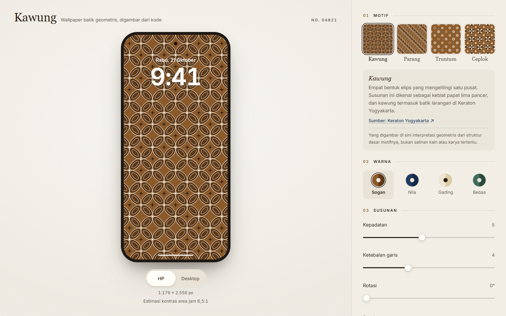
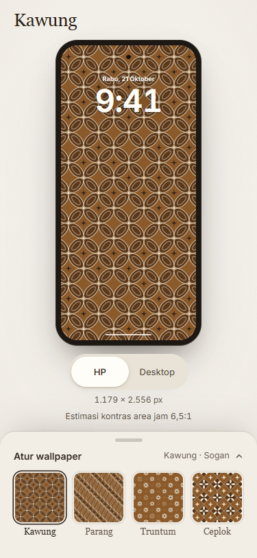
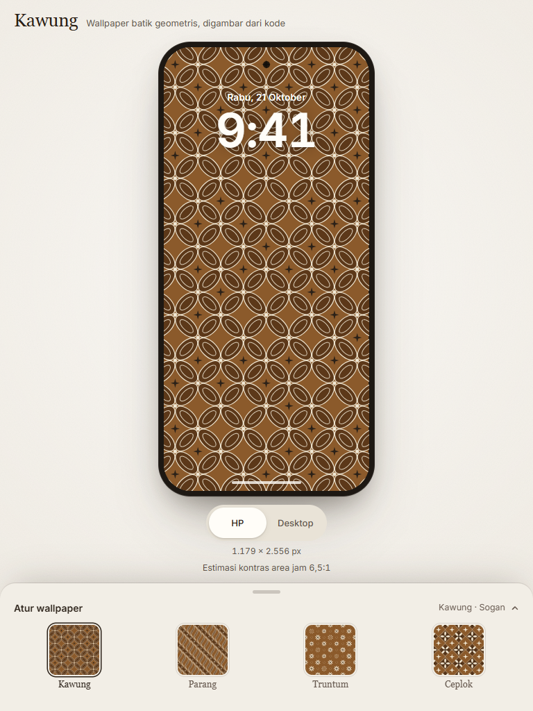
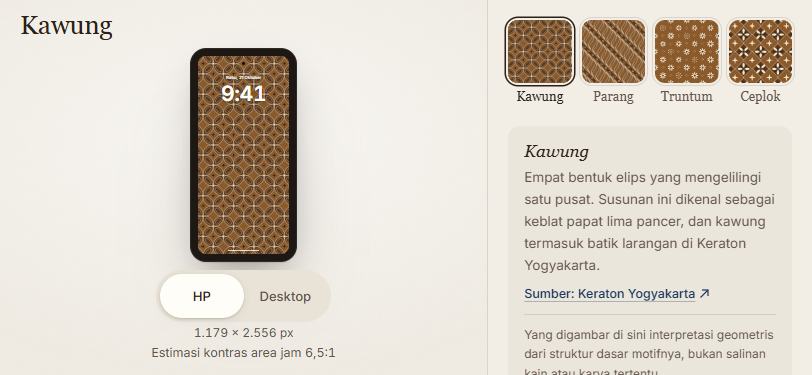

# Kawung — tahap pertama

Selesai lokal pada 21 Oktober 2026. Perubahan ini belum di-push atau di-deploy. Preview build produksi tersedia di `http://127.0.0.1:4186/` selama server lokal berjalan.

## Perubahan produk

- **Preview dan PNG menggunakan ukuran output yang sama.** Lebar/tinggi tersimpan sebagai sisi pendek `x` dan sisi panjang `y` dalam URL. Bingkai berada di luar area gambar; PNG berisi motif tanpa bingkai, jam, atau tanggal.
- **Link mempertahankan komposisi lintas perangkat.** Link lama tanpa ukuran mengambil ukuran layar saat pertama dibuka. Setelah itu ukuran tetap tersimpan, termasuk saat perangkat diputar. Tombol “Gunakan ukuran layar ini” mengubahnya secara eksplisit. Pilihan HP dan desktop menggunakan dua sisi yang sama dengan orientasi berbeda.
- **Panel menyesuaikan ruang.** Desktop dan layar landscape pendek memakai pengaturan di samping preview. Panel portrait memiliki thumbnail yang dibatasi ukurannya sehingga nama motif tablet tetap terlihat. Isi lanjutan benar-benar disembunyikan saat panel tertutup, dan halaman tidak lagi memiliki scroll kosong di desktop.
- **Fokus panel terkelola.** Panel portrait terbuka memakai semantik dialog, latar inert, containment fokus, Escape, dan pemulihan fokus saat ditutup melalui tombol atau backdrop.
- **Status salin sesuai hasil.** Clipboard utama dan fallback diperiksa. Kegagalan menampilkan instruksi salin manual dengan URL terseleksi. Perubahan pengaturan membatalkan status sukses lama; respons clipboard yang terlambat tidak dapat menyatakan link baru sudah tersalin.
- **Klaim produk diperjelas.** Tidak ada janji wallpaper eksklusif atau seed selalu unik. Kontras disebut estimasi median area jam, bukan validasi keterbacaan. Algoritma motif dan pengukuran kontras belum diganti; evaluasi lebih dalam tetap lingkup tahap kedua.

## Verifikasi

| Pemeriksaan | Hasil |
|---|---|
| TypeScript dan production build | Lulus, Node.js 24.19.0 |
| Unit tests | 41 tes / 5 file lulus |
| Suite browser utama | 24 tes lulus di Chrome |
| Regresi setelah perbaikan visual terakhir | Seluruh 12 tes tahap pertama diulang dan lulus |
| Komposisi preview–PNG | 4 motif × 2 orientasi; dimensi PNG, rasio area preview, dan perbandingan raster SVG/PNG lulus |
| Link lintas layar/DPR dan rotasi | Ukuran serta SVG tetap; reset ke layar saat ini bekerja |
| Clipboard | Jalur berhasil, ditolak, fallback berhasil/gagal, dan respons terlambat diuji melalui simulasi API |
| PNG gagal | Error tampil, tombol kembali aktif, retry berhasil |
| Pemeriksaan visual akhir | 7 viewport Chrome dan 3 viewport WebKit lulus |
| axe pada state panel yang diperiksa | 0 temuan otomatis di 10 kombinasi browser/viewport |
| Horizontal/vertical overflow halaman | 0 pada seluruh kombinasi akhir |
| Sentuhan | Slider Chrome dengan sentuhan sintetis mengubah nilai; portrait → landscape tidak meninggalkan modal atau latar inert |
| Impeccable detector | Tidak ada temuan mekanis |

Viewport Chrome: 320×568, 375×812, 390×844, 768×1024, 1024×768, 1440×900, 812×375. WebKit: 375×812, 1440×900, 812×375. Pada landscape 812×375, frame preview sekarang sekitar 107×214 CSS px untuk output contoh 1179×2556, dibanding sekitar 24×53 px pada audit awal dengan rasio HP yang sebanding.

Perbandingan raster mengizinkan perbedaan antialiasing: rata-rata selisih kanal <2 pada skala 0–255, dan <2% piksel memiliki selisih maksimum kanal >24. Ini memeriksa komposisi kedua renderer dalam browser yang diuji, bukan menjanjikan raster identik antar-browser atau resolusi.

Bukti ringkas: [hasil browser](verification/stage-one-browser.json), [hasil tes regresi](verification/stage-one-tests.json). Test source: `e2e/stage-one.spec.ts`.









## Batas verifikasi

- WebKit dijalankan di Windows melalui Playwright; ini bukan tes Safari pada iPhone fisik. Pemasangan wallpaper di perangkat fisik belum diuji.
- Dua executable Firefox yang sudah terpasang gagal diluncurkan dengan `spawn UNKNOWN` sebelum halaman terbuka. Firefox tidak dinyatakan lulus dan tidak ada kesimpulan kegagalan aplikasi dari error launcher itu.
- Perangkat menginjeksi request Kaspersky. Suite menggunakan `E2E_ENVIRONMENT_HOSTS=gc.kis.v2.scr.kaspersky-labs.com` untuk mengecualikan host lingkungan tersebut secara eksplisit; pengecualian default kosong dan tidak mengubah aplikasi atau antivirus.
- Angka kontras dapat berbeda antar-engine rasterisasi. Angka tersebut tetap estimasi; keterbacaan manusia dan representasi lengkap motif tradisional belum divalidasi.
- Ukuran output kustom/preset, undo/redo, favorit, serta peningkatan variasi Ceplok masih berada di tahap berikutnya.

## Menjalankan kembali

Dependency pnpm dikunci dalam `pnpm-lock.yaml`, diimpor dari package-lock saat audit; tidak ada upgrade dependency pada tahap ini.

```sh
pnpm install --frozen-lockfile
pnpm test
pnpm build
pnpm test:e2e
```

Suite secara default membangun dan membuka preview di port 4186. Gunakan `PLAYWRIGHT_EXECUTABLE_PATH` jika ingin memakai Chrome yang sudah terpasang. Jika server build sudah berjalan, arahkan `E2E_BASE_URL` ke URL-nya. `pnpm dev` menggunakan port 4185; `pnpm preview` menggunakan 4186.

## Arah tahap kedua

Evaluasi variasi/duplikasi, kualitas kontras berbasis area teks yang lebih tepat, konsistensi render pada beberapa kondisi, dan biaya komputasi. Perubahan tahap pertama tidak mengubah seed menjadi identitas unik atau mengklaim peningkatan akurasi metrik kontras.
